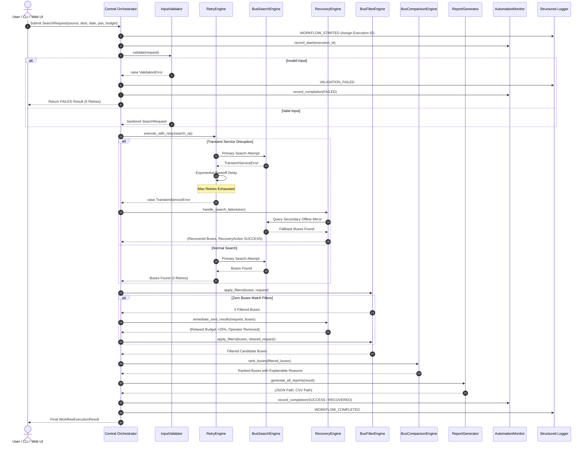

# RedBus Intelligent Ticket Search and Automation System
### An Enterprise Offline-First Autonomics and Workflow Automation Platform

[](https://github.com/KuruvaAshok09/redbus-intelligent-automation/actions)

-brightgreen)


> **⚠️ ACADEMIC & COMPLIANCE NOTICE (SIMULATED DATA):**  
> This project is an individual B.Tech student project developed strictly for **HCLTech Autonomics Role Evaluation**. All bus schedules, pricing, operators, and seat inventories are simulated offline models (`data/sample_buses.json`). It does **not** scrape RedBus, does **not** interact with live booking infrastructure, collects **no** personal passenger data, processes **no** payments, and bypasses **no** anti-bot challenges. The entire application operates 100% offline.

---

## Table of Contents
1. [Project Title](#1-project-title)
2. [Project Overview](#2-project-overview)
3. [Problem Statement](#3-problem-statement)
4. [Project Objectives](#4-project-objectives)
5. [Technology Stack](#5-technology-stack)
6. [System Architecture](#6-system-architecture)
7. [Module Descriptions](#7-module-descriptions)
8. [Automation Workflow](#8-automation-workflow)
9. [Monitoring Architecture](#9-monitoring-architecture)
10. [Incident Detection](#10-incident-detection)
11. [Retry Mechanism (Exponential Backoff)](#11-retry-mechanism-exponential-backoff)
12. [Recovery Mechanism (Self-Healing)](#12-recovery-mechanism-self-healing)
13. [Structured JSON Logging](#13-structured-json-logging)
14. [Operational Reporting](#14-operational-reporting)
15. [Bash Scripting & DevOps](#15-bash-scripting--devops)
16. [Installation Instructions for Windows 11](#16-installation-instructions-for-windows-11)
17. [Git Bash Setup Instructions](#17-git-bash-setup-instructions)
18. [Dashboard Execution (Streamlit)](#18-dashboard-execution-streamlit)
19. [CLI Execution](#19-cli-execution)
20. [Test Execution (Pytest)](#20-test-execution-pytest)
21. [Sample Input and Output](#21-sample-input-and-output)
22. [Sample JSON Log](#22-sample-json-log)
23. [Sample CSV Report](#23-sample-csv-report)
24. [Project Limitations](#24-project-limitations)
25. [Future Enhancements](#25-future-enhancements)
26. [Individual Student Contribution Section](#26-individual-student-contribution-section)

---

## 1. Project Title
**RedBus Intelligent Ticket Search and Automation System**  
*Enterprise Offline-First Workflow Automation, Incident Self-Healing, and Observability Platform.*

---

## 2. Project Overview
The platform demonstrates modern enterprise **Autonomics Engineering** applied to travel search automation. It replaces fragile manual booking searches with a resilient, observable, multi-step pipeline featuring:
- Automated input sanitization and domain rule validation.
- Bounded retries with exponential backoff for transient failures.
- Automated self-healing recovery routines (secondary mirror routing, catalog seed reconstitution, constraint relaxation).
- Deterministic Multi-Criteria Decision Analysis (MCDA) ranking with explainable natural language recommendations.
- Unified structured JSON telemetry and immutable compliance reporting (CSV & JSON).
- Enterprise presentation via both CLI and an interactive Streamlit dashboard.

---

## 3. Problem Statement
Traditional travel booking search scripts suffer from severe enterprise operational deficiencies:
1. **Fragility & Crash Prone:** Upstream network timeouts or transient API blips crash unhardened scripts.
2. **Infinite Retry Traps:** Poorly designed scripts either loop forever on permanent validation errors or fail without retrying temporary blips.
3. **Black-Box Lack of Observability:** Unstructured console `print()` statements prevent enterprise monitoring tools from tracking latencies, failure rates, and health metrics.
4. **Arbitrary Recommendations:** Ranking algorithms rarely explain *why* a particular option was chosen over alternatives.
5. **Lack of Self-Healing:** Any unexpected scenario (such as zero results due to strict budget constraints) halts execution instead of applying intelligent autonomic remedies.

---

## 4. Project Objectives
- Build an offline-first, enterprise-grade Python automation platform without external cloud API dependencies.
- Implement autonomic self-healing (MAPE-K pattern) with bounded retries and automated recovery.
- Establish end-to-end traceability with unique execution IDs and structured JSON logging.
- Provide explainable decision-making in bus ticket recommendations.
- Enable automated continuous integration (CI/CD) and operational shell scripts compatible with Windows 11 Git Bash and Linux.

---

## 5. Technology Stack
- **Language:** Python 3.9+ (Tested on Python 3.10, 3.11, 3.12, 3.14)
- **UI Framework:** Streamlit (v1.30+)
- **Testing Framework:** Pytest (v8.0+)
- **Data Serialization:** Python Standard Library (`json`, `csv`, `dataclasses`, `pathlib`)
- **DevOps & Scripting:** Git Bash, POSIX Shell Scripting, GitHub Actions CI
- **Version Control:** Git, GitHub (`origin/main`)

---

## 6. System Architecture
```
redbus-intelligent-automation/
│
├── redbus_automation/          # Decoupled Core Business & Autonomics Engines
│   ├── __init__.py             # Package exports
│   ├── main.py                 # CLI interface
│   ├── config.py               # Central configuration & paths
│   ├── models.py               # Strongly typed dataclasses & exceptions
│   ├── validator.py            # Input validation & sanitization
│   ├── search_engine.py        # Local catalog search & fault injection
│   ├── filter_engine.py        # Domain constraints & filters
│   ├── comparison_engine.py    # MCDA ranking & explainability
│   ├── orchestrator.py         # Central lifecycle orchestrator
│   ├── retry_engine.py         # Bounded retries & exponential backoff
│   ├── recovery_engine.py      # Autonomic self-healing remediations
│   ├── monitoring.py           # Real-time metrics & observability
│   ├── logger.py               # Structured JSON logging contract
│   └── reporting.py            # CSV & JSON audit report generation
│
├── data/
│   └── sample_buses.json       # 21 verified offline simulated bus schedules
│
├── logs/                       # Structured JSONL execution logs
│   ├── .gitkeep
│   └── automation_execution.jsonl
│
├── reports/                    # Auditable execution reports
│   ├── .gitkeep
│   ├── report_*.csv
│   └── report_*.json
│
├── tests/                      # Pytest automated test suite (67 tests)
│   ├── __init__.py
│   ├── test_validator.py       # Validation boundary tests
│   ├── test_search.py          # Search & fault injection tests
│   ├── test_comparison.py      # MCDA ranking & filtering tests
│   ├── test_retry.py           # Bounded retry & backoff tests
│   ├── test_recovery.py        # Self-healing recovery tests
│   ├── test_reporting.py       # CSV & JSON report integrity tests
│   ├── test_orchestrator.py    # End-to-end integration tests
│   └── test_monitoring.py      # Telemetry & KPI metric tests
│
├── scripts/                    # Shell automation (Windows Git Bash & Linux)
│   ├── setup.sh                # Environment bootstrapping & venv
│   ├── start_app.sh            # Streamlit dashboard launcher
│   ├── run_tests.sh            # Automated test runner
│   └── health_check.sh         # System health & directory auditor
│
├── docs/                       # Comprehensive documentation
│   ├── ARCHITECTURE.md         # Detailed architectural design
│   ├── AUTONOMICS_CONCEPTS.md  # Deep dive into enterprise autonomics
│   └── DEMO_GUIDE.md           # 5-minute demo sequence & 15 interview Q&A
│
├── .github/
│   └── workflows/
│       └── tests.yml           # Multi-Python GitHub Actions workflow
│
├── app.py                      # Enterprise Streamlit Web Dashboard
├── requirements.txt            # Minimal dependency definitions
├── .gitignore                  # Git exclusions
├── README.md                   # Master project documentation
└── PROJECT_STATUS.md           # Milestone & audit tracking record
```

---

## 7. Module Descriptions
- **`validator.py`:** Enforces strict boundary rules. Validates source/destination city format, date validity (rejecting past dates), passenger range [1..10], and positive budgets. Raises permanent `ValidationError` that is never retried.
- **`search_engine.py`:** Reads simulated bus schedules offline from `data/sample_buses.json`. Houses deterministic fault injection hooks for testing resilience.
- **`filter_engine.py`:** Prunes raw buses by budget, passenger seat availability, preferred operators, minimum ratings, and departure time windows.
- **`comparison_engine.py`:** Normalized multi-criteria scoring balancing Fare (40%), Duration (25%), Rating (25%), and Seat Availability (10%). Generates natural-language explainability text.
- **`retry_engine.py`:** Bounded retries with exponential backoff. Retries transient exceptions; rejects permanent validation errors immediately.
- **`recovery_engine.py`:** Self-healing recovery strategies: secondary mirror routing, catalog seed reconstitution, and filter relaxation.
- **`orchestrator.py`:** Central master pipeline coordinator driving step-by-step lifecycle execution and unique execution IDs (`EXEC-...`).
- **`monitoring.py`:** Singleton metrics aggregator tracking total runs, success rate, failure rate, latencies, and active status without double counting.
- **`logger.py`:** Thread-safe structured JSON logger appending to `logs/automation_execution.jsonl`.
- **`reporting.py`:** Generates compliance artifacts in structured CSV and JSON formats in `reports/`.

---

## 8. Automation Workflow


---

## 9. Monitoring Architecture
The system tracks runtime health metrics through `AutomationMonitor`:
- **Total Executions:** Cumulative workflow attempts.
- **Successful Executions:** Runs completing all steps cleanly.
- **Recovered Executions:** Runs completing successfully via self-healing actions.
- **Failed Executions:** Runs halted by validation errors or unrecoverable incidents.
- **Success Rate ($\%$):** $\frac{\text{Success} + \text{Recovered}}{\text{Total}} \times 100$
- **Failure Rate ($\%$):** $\frac{\text{Failed}}{\text{Total}} \times 100$
- **Average Duration (seconds):** Rolling arithmetic mean latency.
- **Double Counting Safeguard:** Deduped via internal execution ID registry.

---

## 10. Incident Detection
The system detects four classes of runtime incidents:
1. **Transient Service Outages:** Unresponsive or timed-out upstream endpoints (`TransientServiceError`).
2. **Catalog Corruption:** Damaged or absent mock data catalogs (`DataFetchError`).
3. **Over-Constrained Zero-Result Outages:** Restrictive user criteria yielding zero candidate buses.
4. **Report Storage IO Locks:** Permission or filesystem failures during artifact creation (`ReportGenerationError`).

---

## 11. Retry Mechanism (Exponential Backoff)
Implemented in `redbus_automation/retry_engine.py`:
- **Bounded Attempts:** Configured to a maximum of 3 retries.
- **Exponential Formula:**
  $$\text{Delay} = \text{Initial Delay (0.05s)} \times (2.0)^{\text{attempt}-1}$$
- **Safety Gate:** Rejects permanent errors (`ValidationError`, `TypeError`, `ValueError`) on attempt 0 without entering the retry loop.

---

## 12. Recovery Mechanism (Self-Healing)
Implemented in `redbus_automation/recovery_engine.py`:
- **`SECONDARY_MIRROR_FALLBACK`:** Activates an offline mirror catalog when primary search fails.
- **`CATALOG_SEED_RECONSTITUTION`:** Rebuilds verified master seed schedules if the local data file is deleted or corrupt.
- **`CONSTRAINT_RELAXATION`:** Relaxes the maximum budget by 25% and drops strict operator filters when user filters yield zero buses.
- **`UnrecoverableIncidentError`:** Escalates critical failure telemetry if all self-healing options fail.

---

## 13. Structured JSON Logging
Every system event is written to `logs/automation_execution.jsonl` using a standardized JSON schema:
- `timestamp`: ISO-8601 string
- `execution_id`: Unique workflow run ID
- `event_type`: Domain event enum (e.g. `WORKFLOW_STARTED`, `RETRY_TRIGGERED`, `RECOVERY_COMPLETED`)
- `severity`: `DEBUG`, `INFO`, `WARNING`, `ERROR`, `CRITICAL`
- `component`: Originating module name
- `message`: Diagnostic log message
- `execution_status`: Current lifecycle status
- `metadata`: Contextual key-value payload

---

## 14. Operational Reporting
Every run produces two compliance artifacts in `reports/`:
- **CSV Report (`report_<EXEC_ID>.csv`):** Tabular format with execution ID, route, duration, status, retries, recoveries, and full bus comparison attributes.
- **JSON Report (`report_<EXEC_ID>.json`):** Hierarchical structured payload with complete request parameters, retry details, recovery actions, and ranked results.

---

## 15. Bash Scripting & DevOps
All shell scripts under `scripts/` are compatible with both **Windows 11 Git Bash** and **Linux Bash**:
- **`scripts/setup.sh`:** Verifies Python, creates `.venv`, activates it, and installs `requirements.txt`.
- **`scripts/start_app.sh`:** Verifies dependencies and launches Streamlit dashboard headless.
- **`scripts/run_tests.sh`:** Runs Pytest test suite with verbose output and propagates exit codes.
- **`scripts/health_check.sh`:** Verifies directories, catalog data, packages, and write permissions.

---

## 16. Installation Instructions for Windows 11

### Prerequisites
- Windows 11 (64-bit)
- Python 3.9+ installed and added to PATH (`python --version`)
- Git for Windows (`git --version`)

### Quick Setup Steps
1. Clone or navigate to the repository:
   ```cmd
   git clone https://github.com/KuruvaAshok09/redbus-intelligent-automation.git
   cd redbus-intelligent-automation
   ```
2. Create and activate a virtual environment:
   ```cmd
   python -m venv .venv
   .venv\Scripts\activate
   ```
3. Install dependencies:
   ```cmd
   python -m pip install --upgrade pip
   pip install -r requirements.txt
   ```
4. Verify installation:
   ```cmd
   python -m pytest tests/ -v
   ```

---

## 17. Git Bash Setup Instructions
In Git Bash on Windows:
```bash
# 1. Run the automated setup script
bash scripts/setup.sh

# 2. Audit system health
bash scripts/health_check.sh

# 3. Execute the full test suite
bash scripts/run_tests.sh
```

---

## 18. Dashboard Execution (Streamlit)
To launch the interactive Web Dashboard:
```bash
# Using Python directly
python -m streamlit run app.py

# Or via Bash script
bash scripts/start_app.sh
```
Open your web browser at: `http://localhost:8501`

---

## 19. CLI Execution
Execute intelligent searches directly from the command line:

```bash
# Standard search on default corridor (Bangalore -> Hyderabad)
python -m redbus_automation.main

# Custom search with parameters
python -m redbus_automation.main --source Bangalore --destination Hyderabad --date 2026-11-20 --budget 1500 --passengers 2

# Demonstrate fault injection and self-healing resilience
python -m redbus_automation.main --source Bangalore --destination Hyderabad --simulate-transient-failure
```

---

## 20. Test Execution (Pytest)
Run the automated test suite:
```bash
# Execute all tests with short traceback
python -m pytest tests/ -v --tb=short

# Run a specific test module
python -m pytest tests/test_retry.py -v
```
**Test Results:** **67 passed in 1.08 seconds** (100% pass rate).

---

## 21. Sample Input and Output

### CLI Command
```bash
python -m redbus_automation.main --source Bangalore --destination Hyderabad --budget 2000
```

### CLI Terminal Output
```
================================================================================
 REDBUS INTELLIGENT TICKET SEARCH & AUTOMATION SYSTEM
 [OFFLINE-FIRST AUTONOMICS DEMONSTRATION - SIMULATED DATA: Offline demonstration only.]
================================================================================

--- WORKFLOW EXECUTION SUMMARY ---
Execution ID     : EXEC-20261113-194947-5A04EC
Status           : SUCCESS
Execution Time   : 0.033 seconds
Buses Evaluated  : 10 found, 9 ranked
Retry Attempts   : 0
Recovery Actions : 0

================================================================================
 ★ TOP RECOMMENDED BUS: GreenLine Travels (BUS-BLR-HYD-108)
   Fare        : ₹900.00
   Departure   : 06:00 -> Arrival: 15:30 (9h 30m)
   Type        : AC Seater Pushback (2+2)
   Rating      : 4.2 / 5.0 ★
   Available   : 22 seats
   Score       : 0.9067
   Reason      : Top Recommendation: Best overall composite value (0.91) with shortest transit duration, high seat availability (22 seats).
================================================================================

--- ALL RANKED OPTIONS ---
Rank  Bus ID               Operator                 Fare      Dep-Arr        Rating   Seats  Score 
------------------------------------------------------------------------------------------------
1     BUS-BLR-HYD-108      GreenLine Travels        ₹900.0    06:00-15:30    4.2      22     0.907 
2     BUS-BLR-HYD-105      SRS Travels              ₹850.0    21:30-07:00    4.0      15     0.900 
3     BUS-BLR-HYD-103      KSRTC (Airavat Club Cl   ₹980.0    20:30-06:00    4.7      24     0.896 
4     BUS-BLR-HYD-101      IntrCity SmartBus        ₹1150.0   21:00-06:30    4.8      18     0.790 
5     BUS-BLR-HYD-110      Go Tour Travels          ₹1100.0   22:00-07:30    4.5      14     0.788 
```

---

## 22. Sample JSON Log
From `logs/automation_execution.jsonl`:
```json
{
  "timestamp": "2026-11-13T19:49:56.812345",
  "execution_id": "EXEC-20261113-194956-808BD3",
  "event_type": "RECOVERY_COMPLETED",
  "severity": "INFO",
  "component": "RecoveryEngine",
  "message": "Self-healing strategy 'SECONDARY_MIRROR_FALLBACK' executed successfully: Recovered from transient error using secondary offline mirror. Retrieved 10 available buses.",
  "execution_status": "RUNNING",
  "metadata": {
    "action_id": "REC-C97C1AEB",
    "strategy": "SECONDARY_MIRROR_FALLBACK"
  }
}
```

---

## 23. Sample CSV Report
From `reports/report_EXEC-20261113-194947-5A04EC.csv`:
```csv
execution_id,status,start_time,end_time,duration_sec,source,destination,journey_date,passengers,max_budget,retries_count,recovery_count,rank,bus_id,operator_name,departure_time,arrival_time,duration,fare,rating,available_seats,composite_score,recommendation_reason,error_message
EXEC-20261113-194947-5A04EC,SUCCESS,2026-11-13T19:49:47.100,2026-11-13T19:49:47.133,0.033,Bangalore,Hyderabad,2026-11-14,1,2500.0,0,0,1,BUS-BLR-HYD-108,GreenLine Travels,06:00,15:30,9h 30m,900.0,4.2,22,0.9067,Top Recommendation: Best overall composite value (0.91) with shortest transit duration, high seat availability (22 seats).,
```

---

## 24. Project Limitations
- **Simulated Offline Data:** Real live RedBus pricing and seat availability fluctuate dynamically in real time; this system intentionally operates on simulated offline data to comply with ethical automation guidelines and avoid web scraping restrictions.
- **Booking & Payments Out of Scope:** By design, real payment gateways, credit card processing, and ticket generation are excluded.
- **Single Host Concurrency:** Monitoring counters use thread locks for process safety; multi-node distributed deployments would require Redis or Kafka for centralized metric aggregation.

---

## 25. Future Enhancements
- **Dynamic Pricing Prediction Engine:** Train a lightweight regression model to forecast seasonal fare fluctuations.
- **Multi-Modal Route Stitching:** Extend the search engine to combine connecting bus and train segments for tier-2 cities.
- **Distributed Telemetry Exporter:** Add OpenTelemetry / Prometheus metrics export endpoints for integration with Grafana.
- **Asynchronous Task Workers:** Implement Celery or RQ workers for running scheduled batch ticket monitoring jobs.

---

## 26. Individual Student Contribution Section
- **Student Name:** Kuruva Ashok
- **Degree / Department:** B.Tech Computer Science and Engineering
- **Institution:** Vel Tech Rangarajan Dr. Sagunthala R&D Institute of Science and Technology
- **Email:** vtu24734@veltech.edu.in
- **GitHub Profile:** [@KuruvaAshok09](https://github.com/KuruvaAshok09)
- **Role Evaluation:** HCLTech Autonomics Role Evaluation
- **Statement of Authorship:**  
  *This project was independently architected, implemented, tested, and documented by me. All core modules—including input validation, multi-criteria decision analysis ranking, bounded exponential retry engines, self-healing recovery strategies, structured JSON telemetry, Streamlit dashboard, Bash operational scripts, and CI/CD automation—were developed as an original individual engineering project.*
