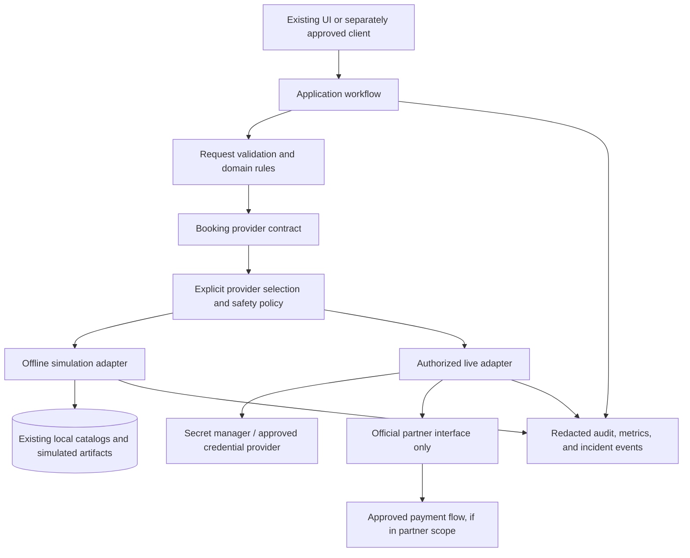

# Future Authorized redBus Integration: Architecture

## Status and scope

This is a **proposed architecture only**. It does not implement a provider, contact redBus, add an API, authorize access, change the application, or make a booking. The existing offline simulation must remain unchanged unless a separately approved implementation task explicitly says otherwise.

| Area | Status |
|---|---|
| Current application | Offline simulation using local catalog data and simulated booking artifacts |
| Provider abstraction and live adapter | Proposed; not implemented |
| Official redBus partner/API access | Pending confirmation and authorization |
| Live search, availability, booking, payment, and PNR verification | Not implemented |

## Current offline architecture

The existing application has a Streamlit dashboard (`app.py`) and a command-line entry point that use `AutomationOrchestrator`. The orchestrator coordinates request validation, catalog search, retry and recovery behavior, filtering, ranking, reporting, monitoring, and incident/log recording.

`BusSearchEngine` reads local JSON catalog data, including the primary and secondary fallback catalogs. `RetryEngine` applies bounded retries to selected transient search failures; after eligible search failures, `RecoveryEngine` can try the local secondary mirror. The results are filtered and ranked by existing domain modules.

The dashboard's booking flow uses `BookingEngine`, which generates a deterministic **simulated** seat layout, validates selected simulated seats, writes a local simulated booking record, and issues a `SIM-PNR-...` reference. This is not a real reservation, provider confirmation, payment, or PNR. The application records operational events and incidents in local JSON Lines files and can generate local reports.

The runtime dependencies in `requirements.txt` are Streamlit and pytest. The existing application does not have a live redBus provider, an official integration contract, payment processing, or live authentication.

## Proposed provider-based architecture

If and only if official access and all required approvals are obtained, a future design could place a provider boundary between workflow orchestration and transport/booking services:

This diagram is conceptual. It does not claim that redBus offers any particular endpoint, protocol, data field, payment method, booking capability, or integration product.

### Provider boundary

A common application-facing contract would describe provider-neutral operations and normalized results. An offline adapter would keep the current local simulation behavior. A separately implemented live adapter would translate the same domain requests to and from the exact interface documented and authorized by redBus. Only that adapter should know provider-specific protocol and schema details.

The provider boundary should not itself make policy decisions such as silently switching a live booking to simulated inventory. It should return an explicit result or typed failure; the workflow and configured operating mode determine safe next steps.

### Coexistence and mode safety

The offline simulation and any future authorized live integration should be separate, explicit operating modes:

- **Simulation is the default** and must continue to work without network access, live credentials, or partner services.
- **Live mode is opt-in**, unavailable until access and approvals are verified, and visibly distinguishable from simulation.
- Provider selection should use a validated allowlist and fail closed for an unknown or unavailable provider. It must not infer live mode from the presence of credentials.
- A live-provider outage must not silently return simulated buses or a simulated confirmation as if it were live. Any permitted fallback to simulation must be an explicit, user-visible mode change that cannot be mistaken for a real booking.
- Search results, availability, booking references, and incident records should retain provenance: provider, mode, correlation identifier, and relevant timestamps, without logging credentials or unnecessary passenger/payment data.
- Live booking and payment operations require stronger controls than read-only search. Separate permissions, confirmation gates, and operational limits should be considered.

The existing application currently has a single offline path. Adding these modes would be a future design and requires separate review of configuration, UX, tests, security, and failure handling.

## Separation of responsibilities

| Responsibility | Proposed owner |
|---|---|
| Request validation and provider-neutral business rules | Application/domain workflow |
| Provider selection, allowed modes, and live safety gates | Explicit configuration and application policy |
| Local JSON search and simulated seat/booking behavior | Existing offline implementation; unchanged |
| Official partner protocol, authentication, and schema translation | Future authorized provider adapter |
| Payment authorization/capture and payment status | Approved payment provider or partner flow, according to formal scope |
| Passenger consent and confirmation of consequential actions | User-facing workflow and approved operational policy |
| Retry classification, idempotency, reconciliation, and escalation | Workflow policy coordinated with provider guarantees |
| Redacted telemetry and incident correlation | Shared observability layer with mode/provider provenance |
| Credential storage and rotation | Approved secret-management service and operations owner |

Do not move provider-specific assumptions into shared domain models or reuse simulated identifiers as live identifiers. Preserve correlation between workflow events and provider operations without persisting sensitive credentials or payment secrets.

## Resilience and transaction boundaries

The current bounded retry/recovery implementation is designed around the offline simulation and must not automatically be assumed safe for live side effects. Search and availability are generally read operations, while booking creation and payment can create irreversible or financially consequential actions.

Before any live implementation, define provider-specific retryability, rate limits, timeouts, idempotency support, and reconciliation behavior from official documentation. A timeout after submitting a booking does not prove that the booking failed. Do not retry a non-idempotent booking or payment request blindly; query/resolve its outcome through an officially supported mechanism or escalate for operator review. Never use the local mirror to substitute for live availability or a live booking.

## Architecture decisions still pending

- Written authorization and exact official partner interface.
- Approved live-use cases, markets, products, and data-processing purposes.
- Ownership of provider credentials and production operations.
- Whether payment is in scope and which approved payment flow is required.
- User consent and confirmation UX for live booking and payment.
- Provider-specific security, privacy, retention, support, and service-level terms.
- Review of changes needed to integrate a provider without altering the existing simulation.

## Related documents

- [Provider interface proposal](./PROVIDER_INTERFACE_DESIGN.md)
- [Proposed live booking workflow](./LIVE_BOOKING_WORKFLOW.md)
- [Integration requirements and pending decisions](./INTEGRATION_REQUIREMENTS.md)
- Existing [system architecture](../../docs/ARCHITECTURE.md)
- Existing [search engine](../../redbus_automation/search_engine.py)
- Existing [booking engine](../../redbus_automation/booking_engine.py)
