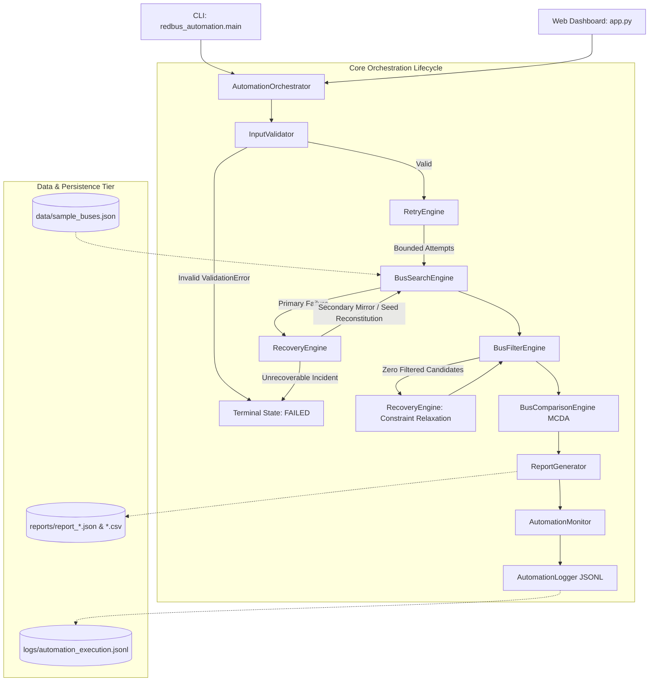

# System Architecture Document
## RedBus Intelligent Ticket Search and Automation System
**Author:** Kuruva Ashok (Individual B.Tech Student Project for HCLTech Autonomics Role Evaluation)  
**Target Repository:** https://github.com/KuruvaAshok09/redbus-intelligent-automation  
**Platform:** Offline-First Enterprise Automation & Autonomics Architecture  

---

## 1. Architectural Overview

The RedBus Intelligent Ticket Search and Automation System is engineered according to enterprise autonomics and clean software architecture principles. It separates domain business logic from user interfaces (CLI and Streamlit), implements deterministic decision analysis, and embeds resilience capabilities (bounded exponential retry, self-healing automated recovery, and structured JSON telemetry).



---

## 2. Module Responsibilities & Separation of Concerns

| Module | File | Core Responsibility |
|---|---|---|
| **Configuration** | `redbus_automation/config.py` | Centralized paths, weights, retry defaults, and simulation notices. Immutable dataclass. |
| **Domain Models** | `redbus_automation/models.py` | Strictly typed dataclasses (`SearchRequest`, `Bus`, `RankedBus`, `WorkflowExecutionResult`) and custom exceptions. |
| **Input Validation** | `redbus_automation/validator.py` | Enforces sanitization, city matching rules, date validity, passenger constraints, and budget limits. Raises permanent `ValidationError`. |
| **Search Engine** | `redbus_automation/search_engine.py` | Offline local JSON catalog reader with controlled fault-injection hooks (transient HTTP 503, corruption, empty data). |
| **Filtering Engine** | `redbus_automation/filter_engine.py` | Applies deterministic domain constraints (budget, seat availability, operator substring, minimum rating, departure time window). |
| **Comparison & Ranking** | `redbus_automation/comparison_engine.py` | Multi-criteria decision analysis (MCDA) using normalized weighted scoring (Fare 40%, Duration 25%, Rating 25%, Seats 10%) with natural-language explainability. |
| **Bounded Retry** | `redbus_automation/retry_engine.py` | Resilient exponential backoff mechanism. Enforces loop bounds and strictly rejects permanent validation exceptions. |
| **Self-Healing Recovery** | `redbus_automation/recovery_engine.py` | Automated remediation strategies (secondary offline mirror cache, seed reconstitution, constraint relaxation) and unrecoverable incident escalation. |
| **Telemetry & Observability** | `redbus_automation/monitoring.py` | Thread-safe operational metrics tracking (total runs, success rate, failure rate, latencies, active status) with double-counting prevention. |
| **Structured Logging** | `redbus_automation/logger.py` | Unified structured JSON logging contract outputting to `logs/automation_execution.jsonl`. |
| **Operational Reporting** | `redbus_automation/reporting.py` | Generates auditable compliance reports in both CSV and JSON formats upon workflow completion. |
| **Central Orchestrator** | `redbus_automation/orchestrator.py` | Single coordinator managing step transitions, unique execution IDs, exception boundaries, and final workflow state. |
| **CLI Client** | `redbus_automation/main.py` | Enterprise command-line interface with formatted outputs, fault injection testing, and standard process exit codes. |
| **Web Dashboard** | `app.py` | Streamlit user interface featuring 6 distinct tabs, real-time KPI tiles, interactive tables, and report download links. |

---

## 3. Data Flow and Execution Lifecycle

1. **Invocation**: A request is initiated either via CLI (`python -m redbus_automation.main`) or Streamlit (`app.py`).
2. **Orchestrator Setup**:
   - Assigns a unique execution ID formatted as `EXEC-YYYYMMDD-HHMMSS-<RANDOM_HEX>`.
   - Transitions state to `RUNNING`.
   - Records start timestamp with `AutomationMonitor` and emits `WORKFLOW_STARTED` to `AutomationLogger`.
3. **Stage 1 — Input Validation**:
   - `InputValidator` checks city name syntax, source vs destination mismatch, ISO date validity, passenger range [1..10], and positive budgets.
   - If invalid, raises `ValidationError`. Workflow terminates immediately as `FAILED` without retrying.
4. **Stage 2 — Search with Bounded Retry**:
   - `RetryEngine` wraps the search call with max 3 attempts and exponential backoff (`delay = initial * (2^(attempt-1))`).
   - If transient disruption occurs, retries are logged. If retries exhaust, `RecoveryEngine` executes `SECONDARY_MIRROR_FALLBACK`.
   - If successful, state is flagged as `RECOVERED`.
5. **Stage 3 — Filtering & Zero-Result Self-Healing**:
   - Filters candidate buses by user constraints.
   - If strict criteria eliminate all available buses on an active route, `RecoveryEngine` executes `CONSTRAINT_RELAXATION` (expanding budget by 25% and removing operator filter).
6. **Stage 4 — Explainable MCDA Ranking**:
   - Buses are normalized across Fare, Duration, Rating, and Seats Available.
   - Deterministic composite score calculated:
     $$\text{Score} = 0.40 \cdot S_{\text{fare}} + 0.25 \cdot S_{\text{duration}} + 0.25 \cdot S_{\text{rating}} + 0.10 \cdot S_{\text{seats}}$$
   - Generates natural language justification explaining why Rank #1 is optimal.
7. **Stage 5 — Reporting & Telemetry**:
   - Generates `reports/report_<EXEC_ID>.json` and `reports/report_<EXEC_ID>.csv`.
   - Updates `AutomationMonitor` total executions, success/failure rates, and duration.
   - Emits `WORKFLOW_COMPLETED` log record.

---

## 4. Error-Handling and Resilience Strategy

The system enforces a clear distinction between **permanent failures** and **transient disruptions**:

```
Error Encountered
│
├── Permanent Error (ValidationError, TypeError, ValueError)
│   └── DO NOT RETRY
│       └── Log VALIDATION_FAILED
│           └── State: FAILED
│               └── Exit Code: 1
│
└── Transient Disruption (TransientServiceError, TimeoutError)
    └── Bounded Retry (Max 3 attempts, Exponential Backoff)
        ├── Succeeded on Retry -> State: SUCCESS
        └── Retries Exhausted
            └── RecoveryEngine Activated
                ├── Fallback Mirror Succeeded -> State: RECOVERED
                └── All Fallbacks Failed -> Escalate UnrecoverableIncidentError -> State: FAILED
```

---

## 5. Security & Offline Guarantee

- **No Real Transactions**: The system strictly simulates booking search logic; no financial transactions, authentication screens, or real RedBus APIs are contacted.
- **Privacy by Design**: No passenger personal data, government IDs, or payment credentials are collected or persisted.
- **Zero Internet Requirement**: All bus catalog data is read from local JSON (`data/sample_buses.json`). After initial `pip install`, the entire test suite, CLI, and Streamlit dashboard operate 100% offline.
